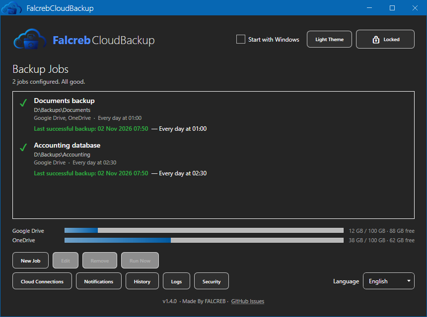
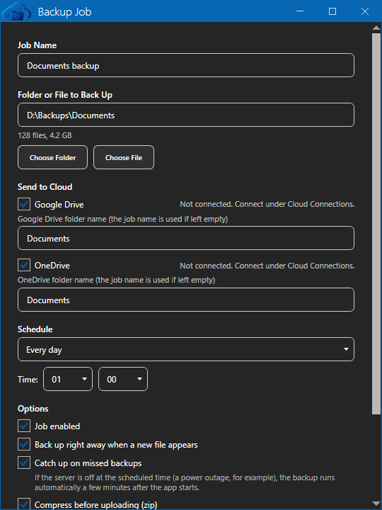
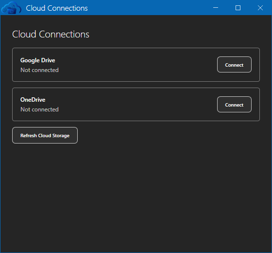
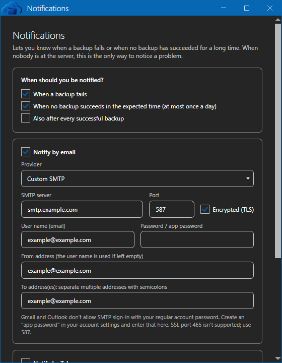
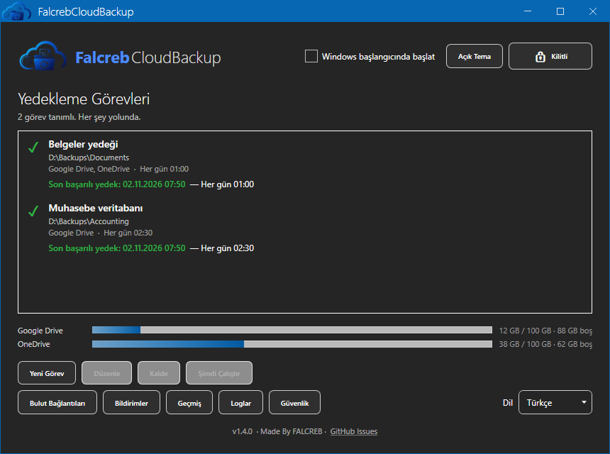
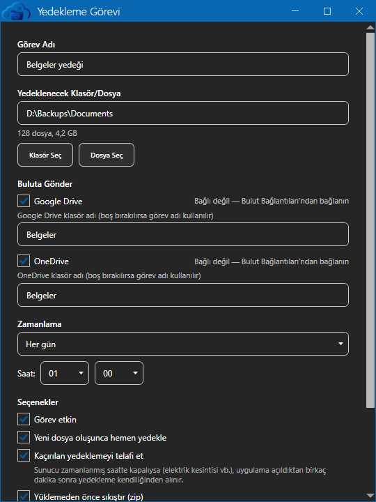
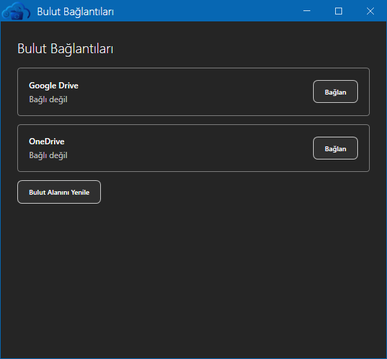
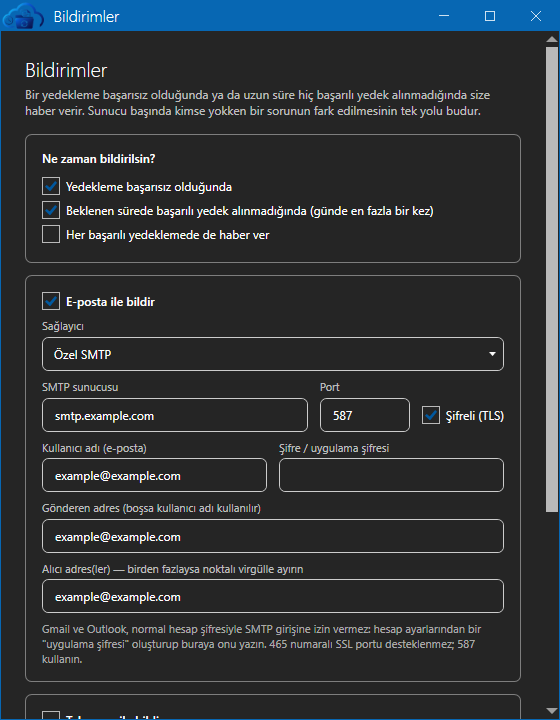

# FalcrebCloudBackup

Reliable Windows backup to Google Drive and OneDrive, with Firebird support, scheduling and integrity checks. Runs on Windows Server 2012 and newer. Made By FALCREB.

[English](#english) · [Türkçe](#türkçe)

---

## English

A lightweight Windows desktop app that automatically backs up a local folder or file to Google Drive and OneDrive, including both at once. It runs on Windows Server 2012 and later and on Windows 10/11. Its original use case is backing up AKINSOFT Wolvox ERP data.

> The app's user interface is available in English and Turkish. It starts in Turkish when the Windows display language is Turkish and in English otherwise. You can change it at any time with the language selector on the main window. Scheduled runs and notifications use the saved language.

### Features

- **Multiple cloud destinations**: one job can upload to Google Drive and OneDrive at the same time.
- **Firebird / Wolvox compatibility**: when the source contains `.fdb`/`.gdb` files, the app takes a consistent, restorable backup with Firebird's own `gbak` tool instead of a raw copy, even while the database is in use. `gbak.exe` is located automatically. Path, user name and password can be set per job, and the password is stored encrypted with DPAPI.
- **Notifications**: email (SMTP) and/or Telegram alerts for failed backups, for backups that did not run on time, and optionally for successful ones. A "Send Test" button checks the settings.
- **Health status**: the main window shows a ✓/✕/⚠ state and the last successful backup time for each job, with a tray alert. A job that silently stopped running is also flagged.
- **Cloud storage tracking**: account usage bars in the app and in notifications, with a warning at 85% and a critical alert at 95%.
- **Missed-run catch-up**: if the machine was off at the scheduled time, the run is caught up through three layers: Windows' "run as soon as possible" setting, a check shortly after the app opens, and a windowless check at boot that needs no user login.
- **Protection against hangs**: time limits and retries on scheduled tasks; backup runs never open a browser and wait; uploads have timeouts, retries and resume.
- **No deletion**: the app has no delete function for backups, by design. Each upload goes to a new timestamped folder.
- **Two triggers**: Windows Task Scheduler (daily, weekly, hourly) and optional file watching on the source folder, throttled to once per 5 minutes per job.
- **Integrity check**: the upload is verified by SHA-256 comparison.
- **Compression**: optional zip before upload.
- **Security**: a local PIN and/or an authenticator app (TOTP), with recovery-code PIN reset and a temporary 3-minute settings unlock.
- **Reliable background operation**: the app shows no lock screen on startup, so scheduled backups keep running after a reboot. Sensitive actions still ask for the PIN or authenticator.
- **Single-instance guard**, daily log files under `%ProgramData%\FalcrebCloudBackup\logs\`, and optional start with Windows.

### Screenshots



| Job editor | Cloud connections | Notifications |
| --- | --- | --- |
|  |  |  |

### Requirements

- Windows Server 2012 or later, or Windows 10/11, with .NET Framework 4.8
- To build: .NET SDK 8.0 or later, on Windows
- To build the installer: [Inno Setup 6](https://jrsoftware.org/isinfo.php)
- Your own Google and/or Microsoft app registration (see [Setup](#setup-your-own-cloud-credentials))

### Build

```powershell
dotnet build FalcrebCloudBackup.sln -c Release
```

The app is written to `src\FalcrebCloudBackup.App\bin\Release\net48\FalcrebCloudBackup.App.exe`. It asks for administrator rights because it registers tasks in Task Scheduler. If your SDK reports missing WPF or .NET Framework build tools, install the ".NET desktop build tools" component of Visual Studio Build Tools.

To build the installer after the Release build:

```powershell
& "ISCC.exe" installer\FalcrebCloudBackup.iss
```

The output is `installer\output\FalcrebCloudBackup-Setup.exe`.

### Setup: your own cloud credentials

This project ships **no** OAuth credentials, and the installer does not bundle any. Each user registers their own app with Google and/or Microsoft and places the resulting file on the machine that runs the backups. You only need to set up the providers you plan to use.

Both files go into `%ProgramData%\FalcrebCloudBackup\`. If the folder does not exist yet, create it from an administrator PowerShell window:

```powershell
New-Item -ItemType Directory -Force "$env:ProgramData\FalcrebCloudBackup"
```

#### Google Drive: `google_client_secret.json`

1. In the [Google Cloud Console](https://console.cloud.google.com/), create a project and enable the **Google Drive API**.
2. Configure the OAuth consent screen with the **External** audience, and add your account as a test user.
3. Create an OAuth client ID of type **Desktop app** and download its JSON file.
4. Rename the file to `google_client_secret.json` and copy it to `%ProgramData%\FalcrebCloudBackup\`.

While the consent screen's publishing status is **Testing**, Google expires refresh tokens after 7 days, so scheduled backups stop until you reconnect. For unattended use, set the status to **In production**. Google may then show an "unverified app" warning at sign-in, for an app you registered yourself. Check Google's current rules on verification in the console.

#### OneDrive: `onedrive_client_config.json`

1. In the [Microsoft Entra admin center](https://entra.microsoft.com/), open **App registrations** and create a new registration.
2. Under supported account types, choose **Accounts in any organizational directory and personal Microsoft accounts**. The app signs in through that authority, so other choices will not work.
3. Under **Authentication**, add the **Mobile and desktop applications** platform with the redirect URI `http://localhost`.
4. Under **API permissions**, add the Microsoft Graph delegated permission `Files.ReadWrite`.
5. Copy the **Application (client) ID** and create `%ProgramData%\FalcrebCloudBackup\onedrive_client_config.json`:

```json
{ "ClientId": "YOUR-APPLICATION-CLIENT-ID" }
```

#### Connect

Open the app, go to **Cloud Connections**, and click **Connect** for each provider. Your browser opens once for consent; later runs reuse the stored session.

### Security notes

- This repository contains no OAuth credentials, passwords or tokens. `.gitignore` also blocks common credential and app-data file names as a safety net. Never commit `google_client_secret.json` or `onedrive_client_config.json`.
- Do not put your own credentials into an installer you distribute. Anyone could extract them from it.
- The app has no server and no telemetry. It talks only to Google, Microsoft, and the SMTP server or Telegram if you enable notifications.
- **Google Drive** uses the `drive.file` scope, so the app sees only files it created. **OneDrive** uses `Files.ReadWrite`, which covers the whole OneDrive, although the app works inside one `FalcrebCloudBackup` folder.
- **Google's refresh token is encrypted with DPAPI** in **LocalMachine** scope and stored as a `.dpapi` file under `%ProgramData%\FalcrebCloudBackup\tokens\google_drive`. A plain JSON token left by an older version is encrypted the first time it is read, and the plain file is deleted only after the encrypted copy has been verified. If the token can't be read (for example, the file was copied from another computer), scheduled backups fail with a "not connected" message and you reconnect in the app. Backup runs never open a browser.
- **The OneDrive token cache** is encrypted by Microsoft's MSAL library with DPAPI in **CurrentUser** scope, so it can be read only by the Windows account that connected.
- SMTP, Telegram and Firebird secrets are also encrypted with DPAPI in **LocalMachine** scope.
- **What LocalMachine scope does and doesn't protect against**: it ties a secret to the machine, not to a single user. A file copied to another computer can't be decrypted, but other software or users on the same machine who can read the file can decrypt it. Restrict access to `%ProgramData%\FalcrebCloudBackup` on shared machines.
- If no Firebird password is set, the app falls back to Firebird's publicly known default (`SYSDBA` / `masterkey`). Set a real password if your server uses one.
- "Disconnect" removes only the local sign-in. To revoke access fully, use your [Google](https://myaccount.google.com/permissions) or Microsoft account settings.
- Test a restore from time to time. The software comes without warranty (see [LICENSE](LICENSE)).

### Support

Please use [GitHub Issues](https://github.com/berkantshn/falcreb-cloud-backup/issues). Do not post credentials, tokens or log files containing private paths.

### Compatibility and trademarks

AKINSOFT Wolvox and Firebird compatibility is a feature only. This project is not affiliated with, endorsed by, or sponsored by AKINSOFT or the Firebird Foundation. Google Drive, OneDrive and other product names are trademarks of their respective owners.

### License

[MIT](LICENSE), Copyright (c) 2026 FALCREB. See [Third-party licenses](#third-party-licenses--üçüncü-taraf-lisansları) for dependencies.

---

## Türkçe

Yerel bir klasörü veya dosyayı Google Drive ve OneDrive'a (ikisine aynı anda da olabilir) otomatik olarak yedekleyen hafif bir Windows masaüstü uygulaması. Windows Server 2012 ve üzeri ile Windows 10/11 üzerinde çalışır. Çıkış noktası AKINSOFT Wolvox ERP verilerini yedeklemektir.

> Uygulamanın arayüzü İngilizce ve Türkçedir. Windows görüntüleme dili Türkçeyse Türkçe, değilse İngilizce açılır. Ana penceredeki dil seçimiyle istediğiniz zaman değiştirebilirsiniz. Zamanlanmış çalışmalar ve bildirimler kayıtlı dili kullanır.

### Özellikler

- **Çoklu bulut hedefi**: Aynı görev, Google Drive ve OneDrive'a aynı anda yükleyebilir.
- **Firebird / Wolvox uyumluluğu**: Kaynakta `.fdb`/`.gdb` dosyası varsa ham kopya yerine Firebird'ün kendi aracı `gbak` ile tutarlı, geri yüklenebilir bir yedek alınır; veritabanı kullanımdayken bile çalışır. `gbak.exe` otomatik bulunur; görev penceresinden yol, kullanıcı adı ve şifre ayarlanabilir (şifre DPAPI ile şifreli saklanır).
- **Bildirimler**: E-posta (SMTP) ve/veya Telegram ile başarısız yedekleme, beklenen sürede yedek alınmaması ve isteğe bağlı başarı bildirimi. "Test Gönder" ile ayar doğrulanır.
- **Sağlık durumu**: Ana ekranda her görev için ✓/✕/⚠ durumu, son başarılı yedek zamanı ve tepsi uyarısı. Sessizce çalışmayı bırakmış görevler de görünür.
- **Bulut alanı takibi**: Hesap doluluğu uygulamada ve bildirimlerde gösterilir; %85'te uyarı, %95'te kritik uyarı gönderilir.
- **Kaçırılan yedeklemenin telafisi**: Bilgisayar zamanlanmış saatte kapalıysa yedekleme üç katmanlı olarak telafi edilir: Windows'un "ilk fırsatta çalıştır" ayarı, uygulama açıldıktan kısa süre sonraki kontrol ve açılışta kullanıcı girişi gerektirmeyen arayüzsüz kontrol.
- **Takılmaya karşı koruma**: Zamanlanmış görevlerde süre sınırı ve tekrar deneme; yedekleme çalışmaları tarayıcı açıp beklemez; yüklemelerde zaman aşımı, yeniden deneme ve kaldığı yerden devam vardır.
- **Silme yok**: Uygulamada yedekleri silen bir işlev kasıtlı olarak yoktur. Her yükleme zaman damgalı yeni bir klasöre gider.
- **Çift tetikleme**: Windows Task Scheduler (günlük, haftalık, saatlik) ve isteğe bağlı dosya izleme (aynı görev en fazla 5 dakikada bir tetiklenir).
- **Bütünlük doğrulama**: Yükleme SHA-256 karşılaştırmasıyla doğrulanır.
- **Sıkıştırma**: Yüklemeden önce isteğe bağlı zip'leme.
- **Güvenlik**: Yerel PIN ve/veya authenticator uygulaması (TOTP), kurtarma koduyla PIN sıfırlama ve 3 dakikalık geçici ayar kilidi açma.
- **Arka planda güvenilirlik**: Uygulama açılışta kilit ekranı göstermez, böylece zamanlanmış yedekler yeniden başlatma sonrasında da sürer. Hassas işlemlerde PIN veya authenticator yine sorulur.
- **Tek kopya koruması**, `%ProgramData%\FalcrebCloudBackup\logs\` altında günlük log dosyaları ve isteğe bağlı Windows ile başlatma.

### Ekran görüntüleri



| Görev düzenleme | Bulut bağlantıları | Bildirimler |
| --- | --- | --- |
|  |  |  |

### Gereksinimler

- Windows Server 2012 ve üzeri ya da Windows 10/11, .NET Framework 4.8
- Derlemek için: Windows üzerinde .NET SDK 8.0 veya üzeri
- Kurulum paketi için: [Inno Setup 6](https://jrsoftware.org/isinfo.php)
- Kendi Google ve/veya Microsoft uygulama kaydınız ([Kurulum](#kurulum-kendi-bulut-kimlikleriniz) bölümüne bakın)

### Derleme

```powershell
dotnet build FalcrebCloudBackup.sln -c Release
```

Uygulama `src\FalcrebCloudBackup.App\bin\Release\net48\FalcrebCloudBackup.App.exe` konumuna yazılır. Task Scheduler'a görev kaydettiği için yönetici izni ister. SDK eksik WPF veya .NET Framework derleme araçları bildirirse Visual Studio Build Tools'un ".NET desktop build tools" bileşenini kurun.

Release derlemesinden sonra kurulum paketi için:

```powershell
& "ISCC.exe" installer\FalcrebCloudBackup.iss
```

Çıktı: `installer\output\FalcrebCloudBackup-Setup.exe`.

### Kurulum: kendi bulut kimlikleriniz

Bu proje OAuth kimliği **içermez**, kurulum paketi de kimlik gömmez. Her kullanıcı Google ve/veya Microsoft'ta kendi uygulamasını kaydeder ve oluşan dosyayı yedek alacak bilgisayara koyar. Yalnızca kullanacağınız sağlayıcıyı ayarlamanız yeterlidir.

İki dosya da `%ProgramData%\FalcrebCloudBackup\` klasörüne konur. Klasör henüz yoksa yönetici PowerShell penceresinden oluşturun:

```powershell
New-Item -ItemType Directory -Force "$env:ProgramData\FalcrebCloudBackup"
```

#### Google Drive: `google_client_secret.json`

1. [Google Cloud Console](https://console.cloud.google.com/) üzerinde bir proje oluşturup **Google Drive API**'yi etkinleştirin.
2. OAuth onay ekranını **External** kitlesiyle yapılandırın, hesabınızı test kullanıcısı olarak ekleyin.
3. **Desktop app** (Masaüstü uygulaması) türünde bir OAuth istemci kimliği oluşturup JSON dosyasını indirin.
4. Dosyanın adını `google_client_secret.json` yapın ve `%ProgramData%\FalcrebCloudBackup\` klasörüne kopyalayın.

Onay ekranının yayın durumu **Testing** iken Google yenileme token'larını 7 günde geçersiz kılar; yeniden bağlanana kadar zamanlanmış yedekler durur. Gözetimsiz kullanım için durumu **In production** yapın. Bu durumda girişte, kendi kaydettiğiniz uygulama için "doğrulanmamış uygulama" uyarısı çıkabilir. Doğrulamayla ilgili güncel kuralları konsoldan kontrol edin.

#### OneDrive: `onedrive_client_config.json`

1. [Microsoft Entra yönetim merkezinde](https://entra.microsoft.com/) **App registrations** bölümünü açıp yeni bir kayıt oluşturun.
2. Desteklenen hesap türlerinde **Accounts in any organizational directory and personal Microsoft accounts** seçin. Uygulama bu yetkiliyle giriş yaptığından diğer seçenekler çalışmaz.
3. **Authentication** altında **Mobile and desktop applications** platformunu `http://localhost` yönlendirme adresiyle ekleyin.
4. **API permissions** altında Microsoft Graph'ın `Files.ReadWrite` (delegated) iznini ekleyin.
5. **Application (client) ID** değerini kopyalayıp `%ProgramData%\FalcrebCloudBackup\onedrive_client_config.json` dosyasını oluşturun:

```json
{ "ClientId": "UYGULAMA-CLIENT-ID-DEGERINIZ" }
```

#### Bağlanma

Uygulamada **Bulut Bağlantıları** ekranını açıp her sağlayıcı için **Bağlan** düğmesine basın. Tarayıcı izin için bir kez açılır; sonraki çalışmalar kayıtlı oturumu kullanır.

### Güvenlik notları

- Bu depoda OAuth kimliği, şifre veya token bulunmaz. `.gitignore` da yaygın kimlik ve uygulama verisi dosya adlarını ek önlem olarak engeller. `google_client_secret.json` ve `onedrive_client_config.json` dosyalarını asla commit etmeyin.
- Kendi kimliklerinizi dağıttığınız bir kurulum paketine koymayın. Herkes onları paketten çıkarabilir.
- Uygulamanın sunucusu ve telemetrisi yoktur. Yalnızca Google, Microsoft ve bildirimleri açtıysanız SMTP sunucusu veya Telegram ile konuşur.
- **Google Drive** `drive.file` kapsamını kullanır, uygulama yalnızca kendi oluşturduğu dosyaları görür. **OneDrive** tüm OneDrive'ı kapsayan `Files.ReadWrite` iznini kullanır, ama uygulama tek bir `FalcrebCloudBackup` klasöründe çalışır.
- **Google yenileme token'ı DPAPI ile şifrelenir** (**LocalMachine** kapsamı) ve `%ProgramData%\FalcrebCloudBackup\tokens\google_drive` altında `.dpapi` dosyası olarak saklanır. Eski sürümden kalan düz JSON token ilk okunduğunda şifrelenir; düz metin dosya, şifreli kopya doğrulandıktan sonra silinir. Token okunamazsa (örneğin dosya başka bir bilgisayardan kopyalandıysa) zamanlanmış yedekler "bağlı değil" mesajıyla başarısız olur ve uygulamadan yeniden bağlanırsınız. Yedekleme çalışmaları asla tarayıcı açmaz.
- **OneDrive token önbelleği** Microsoft'un MSAL kütüphanesi tarafından DPAPI **CurrentUser** kapsamıyla şifrelenir; yalnızca bağlantıyı kuran Windows hesabı okuyabilir.
- SMTP, Telegram ve Firebird şifreleri de DPAPI **LocalMachine** kapsamıyla şifrelenir.
- **LocalMachine kapsamı neyi korur, neyi korumaz**: Sırrı tek bir kullanıcıya değil bilgisayara bağlar. Başka bir bilgisayara kopyalanan dosya çözülemez, ama aynı bilgisayarda dosyayı okuyabilen başka yazılımlar veya kullanıcılar çözebilir. Paylaşılan bilgisayarlarda `%ProgramData%\FalcrebCloudBackup` erişimini kısıtlayın.
- Firebird şifresi girilmezse uygulama Firebird'ün herkesçe bilinen varsayılanını (`SYSDBA` / `masterkey`) kullanır. Sunucunuzda farklı bir şifre varsa onu girin.
- "Bağlantıyı Kaldır" yalnızca yerel oturumu siler. Erişimi tamamen kaldırmak için [Google](https://myaccount.google.com/permissions) veya Microsoft hesap ayarlarınızı kullanın.
- Zaman zaman geri yükleme denemesi yapın. Yazılım garantisiz sunulur ([LICENSE](LICENSE)).

### Destek

Lütfen [GitHub Issues](https://github.com/berkantshn/falcreb-cloud-backup/issues) sayfasını kullanın. Kimlik bilgisi, token veya özel yollar içeren log dosyası paylaşmayın.

### Uyumluluk ve markalar

AKINSOFT Wolvox ve Firebird uyumluluğu yalnızca bir özelliktir. Bu proje AKINSOFT veya Firebird Foundation ile bağlantılı değildir, onlar tarafından onaylanmamış ya da desteklenmemiştir. Google Drive, OneDrive ve diğer ürün adları ilgili sahiplerinin markalarıdır.

### Lisans

[MIT](LICENSE), Copyright (c) 2026 FALCREB. Bağımlılıklar için aşağıdaki tabloya bakın.

---

## Third-party licenses / Üçüncü taraf lisansları

NuGet dependencies keep their own licenses. / NuGet bağımlılıkları kendi lisanslarıyla kullanılır.

| Package / Paket | License / Lisans |
| --- | --- |
| MahApps.Metro, ControlzEx, Microsoft.Xaml.Behaviors.Wpf | MIT |
| Microsoft.Identity.Client, Microsoft.Identity.Client.Extensions.Msal, Microsoft.IdentityModel.Abstractions | MIT |
| Newtonsoft.Json, Otp.NET, QRCoder, TaskScheduler | MIT |
| System.* packages / paketleri | MIT |
| Google.Apis.Drive.v3, Google.Apis, Google.Apis.Auth, Google.Apis.Core | Apache-2.0 |
| Serilog, Serilog.Sinks.File | Apache-2.0 |
| Hardcodet.NotifyIcon.Wpf | [CPOL 1.02](https://www.codeproject.com/info/cpol10.aspx) |

---

## ⭐ Support this project

If this project helped you, please give it a ⭐ and [follow me on GitHub](https://github.com/berkantshn) for more.

İşine yaradıysa projeye ⭐ verip [beni GitHub'da takip edebilirsin](https://github.com/berkantshn).

---

Made By FALCREB
